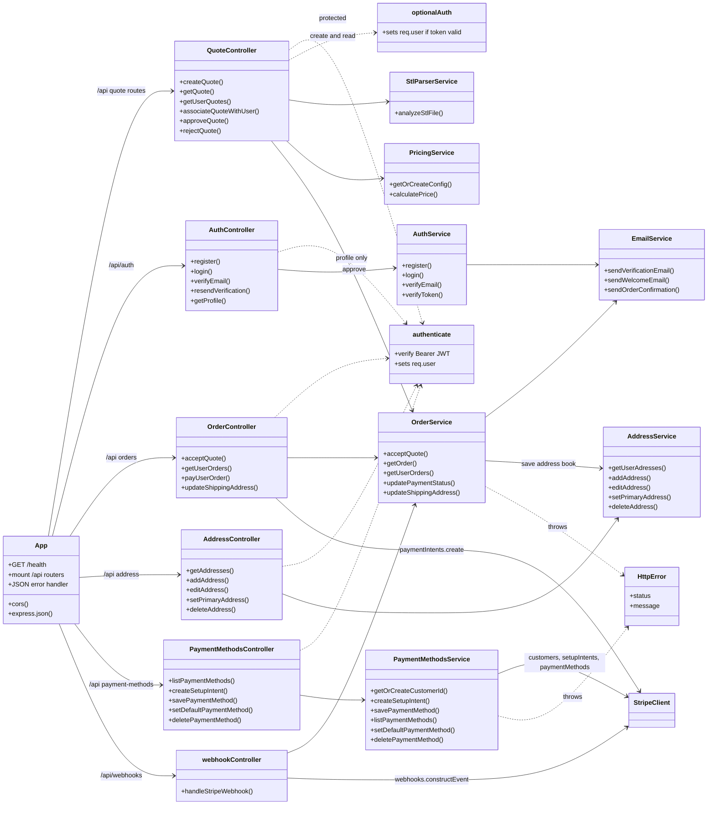
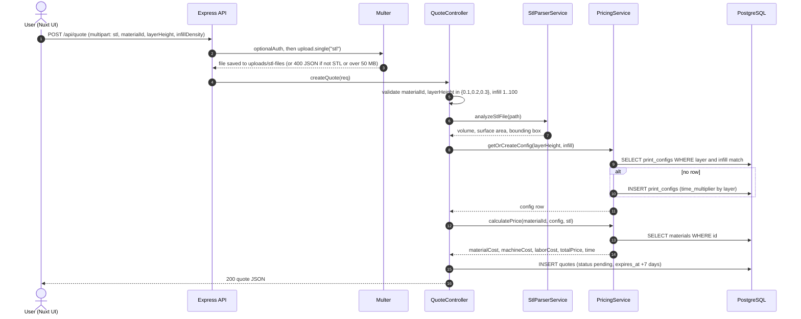
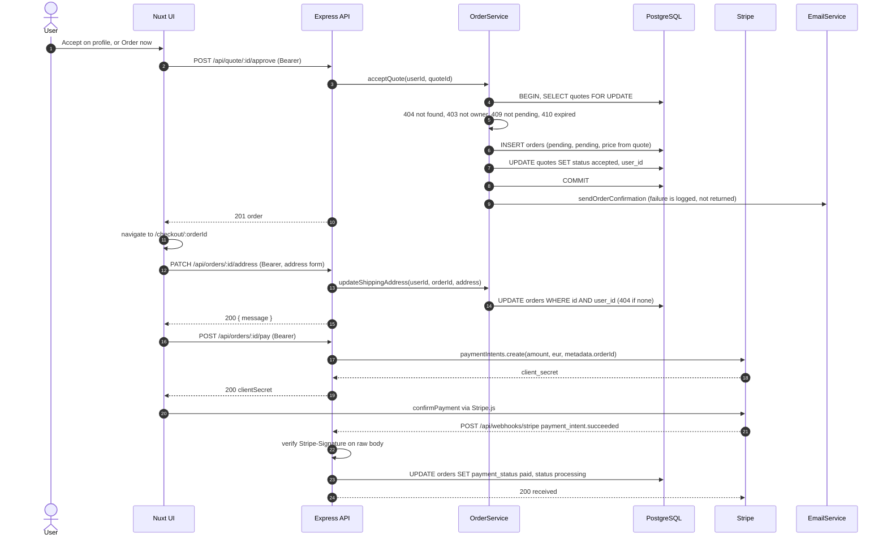
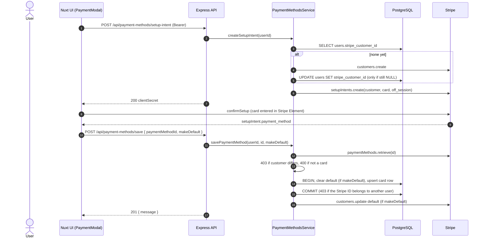
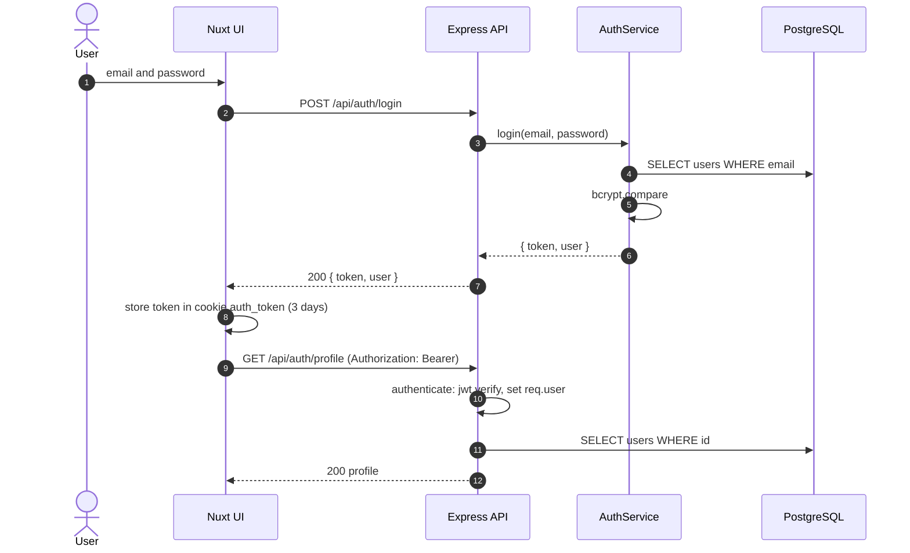

# API Reference and UML

Base URL: `http://localhost:4000/api` (health check at `GET /health`, outside `/api`).

Auth column: **public**, **optional** (token is used when present), **Bearer** (token required; 401 otherwise).

All errors have the shape `{ "error": "message" }`. A 500 hides its cause from the client and logs it on the server.

## Endpoints

### Health

| Method | Path | Auth | Response |
|---|---|---|---|
| GET | `/health` | public | `{ status: "ok", timestamp }` |

### Auth (`/api/auth`)

| Method | Path | Auth | Body | Success | Errors |
|---|---|---|---|---|---|
| POST | `/register` | public | `{ email, password (min 6), firstName?, lastName? }` | 201 `{ token, user, message }` | 400 invalid input, 409 email taken |
| POST | `/login` | public | `{ email, password }` | 200 `{ token, user }` | 400 missing fields, 401 invalid credentials |
| POST | `/verify-email` | public | `{ token }` | 200 `{ message }` | 400 missing or expired token |
| POST | `/resend-verification` | public | `{ email }` | 200 `{ message }` | 400 missing email |
| GET | `/profile` | Bearer | none | 200 `{ id, email, firstName, lastName, username, ... }` | 401, 404 |

`user` in login and register responses is `{ id, email, firstName, lastName, emailVerified }`. Login does not block unverified users; it returns `emailVerified` so the client can decide.

Tokens are signed with `JWT_SECRET`, carry `{ userId, email }`, and expire after `JWT_EXPIRES_IN` (default 7 days). Passwords are hashed with bcrypt, 10 rounds.

### Quotes (`/api`)

| Method | Path | Auth | Input | Success | Errors |
|---|---|---|---|---|---|
| POST | `/quote` | optional | multipart: `stl` (file, `.stl`, max 50 MB), `materialId`, `layerHeight` (`0.1`, `0.2`, `0.3`), `infillDensity` (integer 1 to 100) | 200 quote (below) | 400 missing or unsupported fields, non-STL file, file too large; 500 parse or pricing failure |
| GET | `/quote/:quoteId` | optional | none | 200 raw `quotes` row | 404 not found, malformed ID, or owned by another user |
| GET | `/quotes` | Bearer | none | 200 `{ quotes: [...] }` with `material_name` and `config_name` | 401 |
| POST | `/quote/associate` | Bearer | `{ quoteId }` (a `userId` in the body is ignored) | 200 `{ message }` | 400 `quoteId` not a UUID, 404 not found or already owned |
| POST | `/quote/:quoteId/approve` | Bearer | none | 201 order (same shape as accept-quote below) | 403 owned by another user, 404 not found, 409 already used, 410 expired |
| POST | `/quote/:quoteId/reject` | Bearer | none | 200 `{ message }` | 404 not found, not owned, not pending, or malformed ID |

Quote creation response:

```json
{
  "quoteId": "uuid",
  "filename": "1794589065038-324762813.stl",
  "filepath": "uploads/stl-files/...",
  "volumeCm3": 64.0,
  "surfaceAreaCm2": 96.0,
  "boundingBox": { "x": 4.0, "y": 4.0, "z": 4.0 },
  "pricing": { "materialCost": 0.0, "machineCost": 0.0, "laborCost": 0.0, "totalPrice": 0.0 },
  "materialWeightGrams": 30.55,
  "estimatedPrintTimeMinutes": 100,
  "expiresAt": "2026-11-20T16:57:45.093Z"
}
```

Quotes expire seven days after creation and start with status `pending`. A quote becomes `accepted` when it is approved or accepted into an order. Only `pending` quotes can be approved, accepted, or rejected.

**Approve versus accept:** approve takes no shipping address and is what the UI uses ("Accept" on the profile page and "Order now"). The address is set afterwards at checkout with `PATCH /orders/:orderId/address`. Accept-quote (below) can take the address up front; no UI calls it.

### Orders (`/api/orders`)

| Method | Path | Auth | Input | Success | Errors |
|---|---|---|---|---|---|
| POST | `/orders/accept-quote` | Bearer | `{ quoteId, shippingAddress? }`, where `shippingAddress` is the address shape below | 201 order (below) | 400 missing or malformed `quoteId`, or an address without the required fields; 403, 404, 409, 410 as for approve |
| GET | `/orders` | Bearer | optional `?orderId=` | 200 array, or one order when `orderId` is given | 404 for `orderId` (not found, not owned, or malformed) |
| POST | `/orders/:orderId/pay` | Bearer | none | 200 `{ clientSecret }` | 404 order not found or not owned, 400 already paid, 500 Stripe failure |
| PATCH | `/orders/:orderId/address` | Bearer | address (below) | 200 `{ message }` | 400 invalid address, 404 order not found or not owned |

Address shape (used by accept-quote and the address update):

```json
{
  "firstName": "Mario",
  "lastName": "Rossi",
  "address": "Via Roma 1",
  "addressInfo": "Int 4",
  "city": "Roma",
  "zip": "00100",
  "country": "Italia",
  "isPrimary": true
}
```

`firstName`, `lastName`, `address`, `city`, `zip` and `country` are required and must be non-empty. `addressInfo` and `isPrimary` are optional. The order stores the name as `firstName lastName` and the street as `address, addressInfo`.

When the user has no saved addresses yet, the shipping address is also saved to their address book.

Accept-quote and approve response:

```json
{
  "orderId": "uuid",
  "orderNumber": "ORD-20261113-4821",
  "quoteId": "uuid",
  "totalAmount": 11.11,
  "status": "pending",
  "paymentStatus": "pending",
  "createdAt": "2026-11-13T16:00:00.000Z"
}
```

`totalAmount` is the price stored on the quote. The request cannot change it.

`/orders/:orderId/pay` creates a Stripe PaymentIntent for `Math.round(total_amount * 100)` cents in EUR, with the order ID in its metadata and `allow_redirects: never`. The client confirms it with Stripe.js and the secret.

### Addresses (`/api/address/:userId`)

All routes need Bearer. `:userId` must match the token's user (403 otherwise).

| Method | Path | Body | Success |
|---|---|---|---|
| GET | `/addresses` | none | 200 array |
| POST | `/add` | address | 201 `{ message }` |
| PUT | `/edit/:addressId` | address | 200 `{ message }` |
| PATCH | `/addresses/:addressId/primary` | none | 200 `{ message }` |
| DELETE | `/addresses/:addressId` | none | 200 `{ message }` |

Only one address per user can be primary (partial unique index). Setting a second primary fails in the database and the error is logged, not returned (see open issues).

### Payment methods (`/api/payment-methods`)

Saved cards are Stripe PaymentMethods. The database stores only Stripe IDs, brand, last four digits and expiry. Every user has one Stripe customer, stored in `users.stripe_customer_id` and created on first use.

All routes need Bearer. A card that belongs to another user is reported as 404 (or 403 when saving a card attached to another Stripe customer).

| Method | Path | Body | Success | Errors |
|---|---|---|---|---|
| GET | `/payment-methods` | none | 200 array of cards | 401 |
| POST | `/payment-methods/setup-intent` | none | 200 `{ clientSecret }` | 404 user not found, 500 Stripe failure |
| POST | `/payment-methods/save` | `{ paymentMethodId, makeDefault? }` | 201 `{ message }` | 400 missing ID, not a card, or unknown to Stripe; 403 card belongs to another customer or user |
| PUT | `/payment-methods/:id/default` | none | 200 `{ message }` | 404 |
| DELETE | `/payment-methods/:id` | none | 200 `{ message }` | 404 |

Card object returned by the list:

```json
{
  "id": "uuid",
  "brand": "visa",
  "last4": "4242",
  "expMonth": 9,
  "expYear": 2030,
  "isDefault": true,
  "createdAt": "2026-11-13T16:00:00.000Z"
}
```

Lists are sorted with the default card first. At most one card per user is the default. Setting a new default clears the old one in the same transaction and updates the Stripe customer's default. Deleting a card detaches it from the Stripe customer first. If Stripe reports the card as missing (`resource_missing`), the local row is still removed.

### Stripe webhook

| Method | Path | Auth | Behaviour |
|---|---|---|---|
| POST | `/webhooks/stripe` | `Stripe-Signature` header | Verifies the signature against the raw body. On `payment_intent.succeeded`, the order in `metadata.orderId` gets `payment_status = paid`, `status = processing`, and the PaymentIntent ID. Other events, and events without an order ID, are accepted and ignored. Returns `{ received: true }`. |

This route is mounted before `express.json()` so it receives the raw body.

## UML

### Layer structure (class diagram)



### Quote creation (sequence)



### Approve, shipping, pay and confirm (sequence)



### Saving a card (sequence)



### Login and protected request (sequence)



## Error handling

- Services throw `HttpError` (status and message) for expected failures. Controllers return that status with `{ error }`. Anything else is logged and becomes a 500 with a generic message.
- Errors from the middleware stack (multer, JSON body parsing) go through the error handler in `app.ts`: an oversize or non-STL upload gets 400, and other 4xx errors keep their status. The client never receives Express's HTML error page.
- Stripe rejections for bad input (for example an unknown payment-method ID) return 400 with Stripe's message. Other Stripe failures return 500.
- The address routes log failures from the address service and still return success (see open issues in the [overview](README.md#open-issues)).
