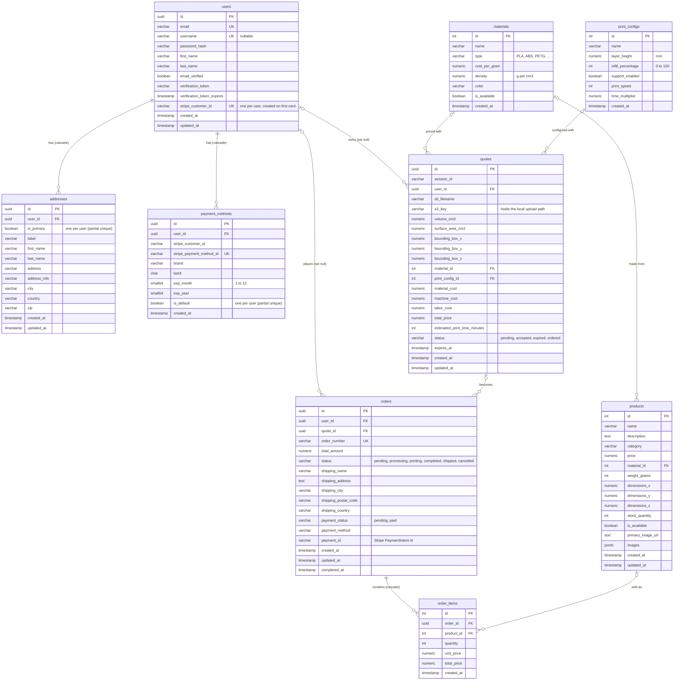

# Database

PostgreSQL 16. The column, index and foreign-key details below were checked against the running database (`information_schema`, `pg_indexes`) and against a fresh database built from `database/init/`. The two match.

## ER diagram

Notes on the diagram:

- `users`, `materials`, `print_configs` and `products` are reference or account data. Quotes and orders are transactional.
- `quotes.user_id` is empty for guest quotes until `POST /api/quote/associate` or approve sets it.
- `orders` copies the shipping address and total from the quote instead of referencing it, so later edits to the quote do not change the order's shipping details.
- `order_items` and `products` exist in the schema but no endpoint writes them yet.

## Table reference

### users

Accounts. Passwords are bcrypt hashes. `verification_token` is a random 32-byte hex string valid for 24 hours; it is cleared when the email is verified. `username` is nullable (six existing accounts have none). `stripe_customer_id` is the user's single Stripe customer, created the first time they add a card.

### addresses

Saved shipping addresses per user. The partial unique index `one_primary_per_user` allows only one row with `is_primary = true` per user. Deleting a user removes their addresses.

### payment_methods

Card references returned by Stripe (no card numbers are stored). `stripe_payment_method_id` is unique. The partial unique index `payment_methods_one_default_per_user_idx` allows one default card per user. Routes and behaviour are described in [api.md](api.md#payment-methods-apipayment-methods).

### materials

Priced materials. Seeded with six rows: PLA White, PLA Black, PLA Red, ABS Black, PETG Clear, TPU Flexible. Pricing uses `density` and `cost_per_gram`. The UI sends material IDs 1 (PLA), 4 (ABS) and 5 (PETG).

### print_configs

A layer height and infill combination, plus `time_multiplier`, which scales print time. Seeded with four presets (Draft, Standard, High Quality, Extra Strong). The API also creates one row per new combination, so the table grows with the combinations customers request, for example `0.1mm / 15%`. `time_multiplier` is 1.5 for 0.1mm, 1.0 for 0.2mm and 0.8 for 0.3mm.

### quotes

One row per priced upload. It stores the STL measurements, the chosen material and config, and the price breakdown at the time of the quote. Quotes expire after seven days (`expires_at`), and expiry is checked when a quote is approved. `status` starts as `pending`; approving or accepting a quote sets it to `accepted`. Only `pending` quotes can be approved or rejected.

### orders

Created from an approved or accepted quote. `order_number` looks like `ORD-YYYYMMDD-NNNN`. `payment_status` moves from `pending` to `paid` when the Stripe webhook arrives, and `status` moves to `processing`. `payment_id` stores the Stripe PaymentIntent ID.

### order_items and products

Designed for pre-printed products (stock, images, dimensions). No endpoint reads or writes them yet.

## Indexes and constraints

| Table | Constraint or index | Purpose |
|---|---|---|
| users | unique `email`, unique `username` (nullable), unique `stripe_customer_id` (nullable) | Login identity and Stripe link |
| addresses | partial unique `(user_id) WHERE is_primary` | One primary address per user |
| payment_methods | unique `stripe_payment_method_id`, partial unique `(user_id) WHERE is_default`, check `exp_month` 1 to 12 | Card references |
| print_configs | check `infill_percentage` 0 to 100 | Valid infill |
| orders | unique `order_number` | Human-readable order number |
| quotes, orders | indexes on `user_id`, `status` (and `session_id` on quotes) | Lookups by user and status |
| payment_methods | index on `user_id` | Lookups by user |

## Migrations

`database/init/01-schema.sql` and `02-seed.sql` run only when the `postgres_data` volume is created empty. `01-schema.sql` is the full current schema, so a new volume is complete on its own.

Migrations in `database/migration/` are the history of changes. They run in this order on an existing database:

| Order | File | Effect |
|---|---|---|
| 1 | `init/01-schema.sql` | Full schema (see above) |
| 2 | `init/02-seed.sql` | Materials and print configs |
| 3 | `migration/add-email-verification.sql` | `users.email_verified`, `verification_token`, `verification_token_expires` |
| 4 | `migration/add-user-address.sql` | Adds address columns to `users` |
| 5 | `migration/create-address-table.sql` | Creates `addresses`, moves the user address out of `users` |
| 6 | `migration/create_payment-method-table.sql` | Creates `payment_methods` |
| 7 | `migration/07-add-users-stripe-customer-id.sql` | Adds `users.stripe_customer_id` |

Migrations 3 to 6 are already included in `01-schema.sql`, and they are not idempotent (they fail if the column or table exists), so run them only on a database created before the schema was consolidated. Migration 7 uses `IF NOT EXISTS`, so it is safe to run again.

**Verification performed:** a fresh Postgres 16 container built from `database/init/` was compared with the live database: all columns (including types, nullability, lengths and precision), all indexes, and all foreign keys matched. Row counts differ only where data was added (the live database has five extra print configs from quote requests).

The Prisma model in `prisma/schema.prisma` does not have `users.stripe_customer_id` yet. Nothing at runtime uses the Prisma model, so the SQL in `database/` is the source of truth. A schema change must be made in SQL and then mirrored in `prisma/schema.prisma` if the Prisma CLI is still used.
